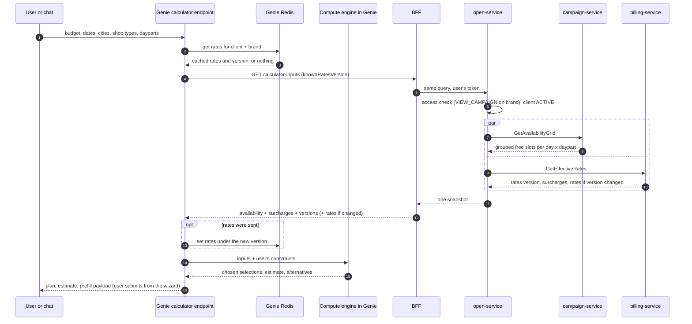

# Calculator Inputs API

**Status:** design, ready to build · **Date:** 2026-10-28 (rev 3: option (b) decided; engine built in `service/genie/calculator/`)
**For:** the backend developer building the endpoint, and the developer building the calculator's compute engine.
**Source of truth for the rules quoted here:** `CAMPAIGN_CREATION_GUIDE (1).md` (as of 2026-10-26). Section numbers like
"§7.2" point into that guide.

---

## 1. What this is, in one paragraph

The Genie calculator turns *"₹X, these dates, these cities"* into the best broadcast campaign. To do that it needs two
things before it chooses anything: **which screens are free** across the dates and dayparts, and **what each slot costs
the brand**. This document specifies **one new read-only endpoint, `calculator-inputs`**, that returns both in a single
snapshot. The rates half is cached in Genie's Redis and only re-sent when it changes; the availability half is always
fresh.

**Scope (v1):** Media Partner, BROADCAST, `NON_PREMIUM` only. Premium is out of scope (no premium inventory today).
Advertising Partners (resellers) come later. Targeted campaigns are not covered.

---

## 2. Why one inputs API (and not one or three APIs)

| Option | Calls per calculation | Verdict |
|---|---|---|
| **A. Separate APIs**: availability, rates, `simulate-cost` | 3 | The compute side has to join two answers taken at different moments and work out which rate row wins (brand-specific vs partner-wide), and the request is access-checked twice. Works, but loose. |
| **B. One inputs API** (+ `simulate-cost` only if needed, §5.3) | 1, sometimes 2 | **Chosen.** Availability and rates share the same keys (city × shop type × daypart) and are always needed together. One snapshot, one access check, rate-row precedence resolved on the server, and the rates half can be skipped when unchanged. |
| **C. One "plan" API that also optimises** | 1 | The optimiser would move into the Java backend, where it is slower to iterate on and outside Genie. Not now. |

**Why not just reuse `GET /api/v1/client-rate-cards` for rates:** it returns raw rows, so the caller must decide
brand-specific vs partner-wide itself; it has no version to cache on; and it takes one filter combination per call.

---

## 3. Flow

### 3.1 The flow at a glance

```
Genie POST /v1/genie/calculator
   │
   ├─0─ Redis: genie:calc:rates:{clientId}:{brandId}  → cached rates + their version (or nothing)
   │
   ├─1─► BFF  GET /api/v1/campaigns/calculator-inputs?…&knownRatesVersion=<cached version>
   │            └─► open-service (access + client ACTIVE)
   │                  ├─ gRPC campaign-service: GetAvailabilityGrid ┐ in
   │                  └─ gRPC billing-service:  GetEffectiveRates   ┘ parallel
   │◄──────────── availability (always) + surcharges (always) + versions (always)
   │              + rates (only when the version differs from knownRatesVersion)
   │
   ├─ new rates? → write them to Redis under the new version
   │
   ├─ compute engine (Python, in Genie): rank, fill to budget, check against the best possible plan, pick alternatives
   │     brand price computed exactly from the rates (§5.2)
   │
   ├─(2)─► BFF  POST /api/v1/campaigns/simulate-cost   ── only if the decision in §5.3 is option (a)
   │
   ▼
plan + estimate + prefill payload  →  the wizard shows its own price preview; the user submits (Genie never submits)
```

### 3.2 The same flow as a sequence



---

## 4. The endpoint

```
GET /api/v1/campaigns/calculator-inputs        (BFF)
GET /v1/open/campaigns/calculator-inputs       (open-service)
```

**GET, under `/api/v1`.** Genie reads the BFF only through `ontology/endpoints.yaml`, whose loader accepts **GET paths
under `/api/v1/` only**, each checked against `reference/bff-openapi.json`. A POST or a `/api/v2` path cannot be
registered. **It is read-only: it writes nothing, holds nothing and emits no event.**

**Roles (BFF):** the existing campaign role list (ADOPS_ADMIN, SUPER_ADMIN, AD_PARTNER_ADMIN, CAMPAIGN_MANAGER,
BRAND_MANAGER …). **open-service:** `@RequireAccess(VIEW_CAMPAIGN)` on the subject (the advertised brand), client status
category `CAMPAIGN_WRITE` (ACTIVE), like availability search.

### 4.1 Request (query parameters)

```
GET /api/v1/campaigns/calculator-inputs
    ?clientId=MP-0001
    &advertisedBrandId=BRD-MP0001-0003
    &startDate=2026-11-01&endDate=2026-11-30
    &deviceTier=NON_PREMIUM
    &timeSlots=MORNING&timeSlots=EVENING
    &cities=DEL&cities=GGN
    &shopTypes=GROCERY
    &knownRatesVersion=r-9f3c1a
```

Lists are repeated parameters (Spring binds `List<…>` from them).

| Param | Type | Required | Notes |
|---|---|---|---|
| `clientId` | string | yes | The operating client (the Media Partner). |
| `advertisedBrandId` | string | yes | Must be a brand whose parent is `clientId`. Selects brand-specific rates. |
| `startDate`, `endDate` | `yyyy-MM-dd` (IST) | yes | Inclusive. Start today or later. Max 92 days. |
| `deviceTier` | enum | yes | `NON_PREMIUM` only. |
| `timeSlots` | `TimeSlots`, repeated | no | `MORNING` 10–13, `AFTERNOON` 13–16, `EVENING` 16–19, `NIGHT` 19–22 (IST). Default all four. |
| `cities` | `CityCode`, repeated | no | `DEL, GGN, NOI, MUM, BLR, HYD, CHN, PUN, OTHERS`. Absent = all. **Filters availability only.** |
| `shopTypes` | `ShopTypes`, repeated | no | Absent = all. **Filters availability only.** |
| `knownRatesVersion` | string | no | The rates version the caller already holds. If it equals the current one, `rates` is omitted. |

**No image/video slot count.** The response gives free *slots*, so the calculator can test any slot count without
another call.

**Filters never narrow `rates`.** `rates` is always the brand's **full matrix** (every city × shop type × daypart the
partner has priced). That is what lets one cached copy serve every query for that brand.

### 4.2 Response

```jsonc
{
  "success": true, "code": "OK", "message": null,
  "data": {
    "snapshotAt": "2026-10-28T11:04:12+05:30",
    "days": ["2026-11-01", "2026-11-02", "…", "2026-11-30"],   // every per-day array below is aligned to this

    "versions": {                // ALWAYS present, whatever was sent
      "rates": "r-9f3c1a",
      "reach": null
    },

    "availability": {            // ALWAYS fresh, never cached by the server
      "groups": [
        { "id": "g1", "city": "DEL", "shopType": "GROCERY", "loopSeconds": 60,
          "devices": 42,
          "contractId": "CTR-MP0001-002",
          "free": {
            "MORNING": { "image": [3,3,3,…], "video": [2,2,2,…] },
            "EVENING": { "image": [3,3,…,1,1], "video": [2,2,…,0,0] } } }
      ],
      "closedCells": [{ "date": "2026-11-01", "timeSlot": "MORNING" }]
    },

    "surcharges": [{ "date": "2026-11-12", "multiplier": 1.5 }],   // ALWAYS present; dated, so not part of `rates`

    "ratesUnchanged": false,     // true → `rates` is null; use your cached copy of versions.rates
    "rates": {
      "unit": "INR per slot per month per daypart",
      "playsPerMonth": 5400,
      "cells": [
        { "city": "DEL", "shopType": "GROCERY", "timeSlot": "MORNING",
          "imageMonthly": 16200.00, "videoMonthly": 27000.00, "source": "BRAND" }
      ],
      "missing": [{ "city": "GGN", "shopType": "DAIRY", "timeSlot": "NIGHT" }]
    }
  }
}
```

### 4.3 Response fields

| Field | Meaning |
|---|---|
| `snapshotAt` | When the availability was read. Show it next to the plan; holds expire every 10 minutes, so it ages fast. |
| `days[]` | Every date from `startDate` to `endDate`. Index *k* of every per-day array means `days[k]`. |
| `versions.rates` | Always sent. A short hash over the rate rows that make up `rates` (§6.4). Any rate change → a new value. |
| `versions.reach` | Always `null` in v1. |
| `groups[]` | Screens grouped by **identical free-slot pattern**. One group = `devices` screens that are interchangeable for booking. |
| `groups[].loopSeconds` | 60 for non-premium. Plays per daypart = 10,800 ÷ `loopSeconds` = **180**. |
| `groups[].contractId` | The contract a booking would draw on first (unshared first, then oldest; §8.5). Informational; only matters if the budget is ever measured on the wallet leg (Q1). |
| `free.<timeSlot>.image[k]` | Free HERO (image, 10 s) slots on each screen of the group on `days[k]`. |
| `free.<timeSlot>.video[k]` | Free SHOWCASE (video, 15 s) slots, same meaning. |
| `closedCells[]` | Cells that have already ended today. Their values in `free` are `0`; the engine neither checks nor bills them, as search drops them from its grid (§7.2 step 1). |
| `surcharges[]` | Days in the range with a price multiplier; highest applicable per day already chosen. Unlisted days are 1.0. |
| `ratesUnchanged` | `true` when `knownRatesVersion` equals `versions.rates`; `rates` is then `null`. |
| `rates.cells[]` | The **effective brand rate** per city × shop type × daypart: brand-specific row if one exists, else partner-wide (`source`). |
| `rates.playsPerMonth` | Divisor for brand rate cards: 30 × 10,800 ÷ 60 = **5,400** per daypart (§12.2). |
| `rates.missing[]` | Cells with no rate. A campaign using them is refused at create (`BRAND_RATE_NOT_SET`). |

### 4.4 Errors

| Case | HTTP / `code` |
|---|---|
| Missing param, `endDate < startDate`, range > 92 days, `startDate` in the past | 400 `VALIDATION_ERROR` |
| `deviceTier` other than `NON_PREMIUM` | 400 `CALCULATOR_TIER_NOT_SUPPORTED` |
| Brand is not under this client | 400 (existing `ERR_ADVERTISED_BRAND_*` sentences) |
| Caller lacks VIEW_CAMPAIGN on the brand | 403 `FORBIDDEN` |
| Client not ACTIVE | 423 `CLIENT_BLOCKED` |
| Client is an Advertising Partner | 400 `CAMPAIGN_CLIENT_TYPE_NOT_ELIGIBLE` |

Standard envelope `{ success, code, message, data }` throughout. Genie treats `success:false` on a 200 as an error.

---

## 5. For the compute engine: how to use the response

### 5.1 The one rule that matters: a screen must fit in *every* chosen cell

A campaign books **the same screens on every chosen day and daypart**. Availability search and the hold accept a screen
only if its **tightest** cell fits: `MIN(free)` across all chosen dates × dayparts ≥ slots requested (§7.2 step 5).

For a candidate plan with dayparts `S`, days `K`, `i` image slots and `v` video slots:

```
group g fits  ⇔  for every s in S and every k in K:
                     g.free[s].image[k] ≥ i   and   g.free[s].video[k] ≥ v

screens available for (city, shopType) = Σ g.devices over groups g of that (city, shopType) that fit
```

**Do not add up per-day or per-daypart counts.** "4 free on Monday" and "4 free on Tuesday" may be different screens,
and a screen free in MORNING may be booked in EVENING. The groups exist so you never have to.

Skip cells in `rates.missing`: a plan that uses them cannot be created.

### 5.2 Plays and the brand price

Per screen, per chosen daypart, per day:

```
plays          = (10,800 ÷ loopSeconds) × (i + v)                  = 180 × (i + v)  on a 60 s loop
price_per_day  = (i × imageMonthly + v × videoMonthly) × 180 ÷ 5,400
               = (i × imageMonthly + v × videoMonthly) ÷ 30        (× the day's surcharge multiplier)
```

Brand price of a plan = Σ over (city, shopType) × chosen dayparts of
`deviceCount × price_per_day × Σ_days multiplier(day)`, image and video legs each rounded once to 2 decimals, half-up.

**This is the same formula billing uses for the brand leg** (`BillingHelper.priceOfPlays`: monthly rate × plays ÷
plays per month, divide last, round once; §12.2). The brand rate is keyed by city × shop type × daypart only, so it does
not depend on *which* screens are taken. With current rates and surcharges the result matches `simulate-cost`'s
`totalCost` to the paisa (confirm the rounding unit with backend, Q4).

**Test vector** (guide §12.3 example A): 4 GROCERY screens in DEL, 3 days, MORNING + EVENING, 2 image + 1 video,
image ₹16,200/month, video ₹27,000/month.
`price_per_day = (2 × 16,200 + 27,000) ÷ 30 = ₹1,980` → `1,980 × 4 screens × 2 dayparts × 3 days =` **₹47,520.00** ✔.
With a 1.5× surcharge on the middle day: `1,980 × 4 × 2 × 3.5 =` **₹55,440.00** ✔.

### 5.3 The quote: does Genie call `simulate-cost`? (decision needed)

`simulate-cost` is a **POST** (`/api/v1/campaigns/simulate-cost`). It saves nothing (§7.5), but Genie's endpoint
registry accepts GET only.

| | (a) Genie calls `simulate-cost` | (b) Genie does not; the wizard does |
|---|---|---|
| How | Add a narrow, reviewed exception to `endpoints.yaml`: a `post_read` entry with a `why` and its guide citation; the loader allows POST only for listed entries, and a test pins the list to `simulate-cost`. | The plan shows Genie's brand-price figure (§5.2) as an **estimate**. The prefill lands in the wizard, whose own price preview calls `simulate-cost`. |
| Needed when | The budget caps the **wallet** leg (Q1): that leg depends on which contract the screens come from, which only billing knows. | The budget caps the **brand price**: §5.2 already reproduces it. |
| Cost | Weakens the GET-only rule, deliberately. | None; the rule stays absolute. |

**Decided 2026-10-28: (b).** Genie does not call `simulate-cost`; the wizard's own preview does. Revisit only if Q1 comes
back "wallet" (then (a), v1 only — the registry does not allow `/api/v2`).

### 5.4 From a chosen plan to the prefill

The wizard takes **one set of time slots for the whole campaign** and one `deviceCount` per (city, shop type):
`timeSlots: [...]`, `imageSlotsRequested`, `videoSlotsRequested`, `selections: [{ city, shopType, deviceCount }]`,
`deviceTier: "NON_PREMIUM"`. (If `simulate-cost` is used, the same selections are repeated once per chosen daypart:
`selections: [{ city, shopType, deviceCount, timeSlot }]`, §7.5.)

### 5.5 What v1 does not do

Reach / unique audience (no data source yet; the plan reports **plays / impressions**, not people), premium screens,
targeted campaigns, Advertising Partners.

---

## 6. Caching (Genie side, Redis)

Genie already has the store for this: `service/genie/store.py` (`KeyValue`: `get`, `set` with a mandatory TTL,
`delete`), Redis when `GENIE_REDIS_URL` is set, process memory otherwise. Redis failing degrades to a cache miss, never
an error. Keys use the `genie:` prefix.

### 6.1 Is the response cacheable?

| Part | Cache it? | Why |
|---|---|---|
| `rates` | **Yes, shared per client + brand, validated on every use** | Changes only when a partner edits a rate card (Save & Lock). The version makes staleness impossible: every calculation sends `knownRatesVersion`, so the server says whether the copy is still right. |
| `availability` | **No shared cache.** Optional per-user dedupe, ≤ 60 s | Holds appear and expire every 10 minutes, and bookings land at any moment. A stale copy offers screens the hold will refuse (`CAMPAIGN_SCREENS_NO_LONGER_AVAILABLE`). |
| `surcharges` | No — always in the response | Dated; tiny. |
| Whole response | Only as the ≤ 60 s per-user dedupe above | See below. |

The structure suits caching: plain JSON, self-describing (`days[]`, `versions`, `snapshotAt`), no user-specific fields,
and the cacheable half (`rates`) is separable and date-independent.

### 6.2 The rates cache

```
key    genie:calc:rates:{clientId}:{advertisedBrandId}
value  {"version": "r-9f3c1a", "playsPerMonth": 5400, "cells": [...], "missing": [...], "storedAt": "..."}
ttl    6 h   (bounds memory only; correctness comes from the version check)
size   ~8 cities × ~10 shop types × 4 dayparts ≈ 320 cells ≈ 30–40 KB
```

Per calculation:
1. Read the key. If found, send its `version` as `knownRatesVersion`.
2. Response `ratesUnchanged: true` → use the cached cells. Otherwise → use `rates` and overwrite the key.
3. Redis down → no `knownRatesVersion`; the server sends `rates`; nothing breaks.

**Why sharing across users is safe:** the cached rates are only ever used inside a request that has just made a live,
access-checked call to `calculator-inputs` with the user's own token. A user who may not see this brand gets a 403 on
that call, and the cached copy is never read for them. **Never serve cached rates when the live call failed.**

If `contractRates` is ever added (Q1), it is partner-cost data with narrower visibility: give it its own key, or keep it
out of the cache.

### 6.3 The optional availability dedupe

For a user dragging the budget slider over the same inputs:

```
key    genie:calc:inputs:{userId}:{sha256(normalised query)}     -- userId from `me`, as sessions do
value  the availability + surcharges + versions part of the response
ttl    min(60 s, seconds until the current daypart ends)          -- so closedCells is never stale
size   ~100 KB
```

Keyed by user so a cached answer is never served across an access boundary. Show `snapshotAt` in the plan.
Local Redis (docker-compose) runs with `maxmemory 128mb` and `volatile-lru`; at ~100 KB per entry and a 60 s TTL this is
negligible.

---

## 7. For the backend: how to build it

### 7.1 Where each part lives

Domain services never call each other; open-service orchestrates (guide §3).

| Layer | Work |
|---|---|
| **ag-dashboard-bff** | Pass-through `GET /api/v1/campaigns/calculator-inputs`, existing campaign role list. Add it to the OpenAPI spec (Genie's tests check every path against it). |
| **ag-open-service** | `CalculatorInputsService`: validation, `@RequireAccess(VIEW_CAMPAIGN)` on the brand, client ACTIVE, the two gRPC calls **in parallel**, `days[]`, `ratesUnchanged`, the envelope. |
| **ag-campaign-service** | gRPC `GetAvailabilityGrid`: free slots per screen × day × daypart, grouped by pattern **in SQL**. |
| **ag-billing-service** | gRPC `GetEffectiveRates(clientId, brandId, startDate, endDate, knownVersion)`: the full effective matrix, its version, the surcharges for the range; the matrix omitted when `knownVersion` matches. |

### 7.2 Tables read

**campaign-service**

| Table | Used for |
|---|---|
| `device_slot_capacity` | One row per screen × client: max image / video slots. Only `availability_status = READY`. Carries the screen's city and shop type. |
| `slot_lease` | The client's ACTIVE leases per zone (HERO = image, SHOWCASE = video) with dates. Room per day. |
| `campaign_device_booking` | Used slots per screen × date × daypart (`image_slots`, `video_slots`). |
| `device_inventory` → `batch` → `program` | Screen → batch → loop length and tier (`PROGRAM_60` = non-premium). |
| `store_replica` | City / shop type, if not taken from the capacity row. |
| `client_batch_allocation`, `contract_replica` | Batch → contract, contract status and dates (for `contractId`). |
| `client_replica` | Client status. |

Not needed: `campaign_device_slot`, `campaign_metadata`, `campaign_store_selection`, `creative`, `campaign_outbox`,
`epg_snapshots`.

**billing-service**

| Table | Used for |
|---|---|
| `billing_client_rate_card` | Brand price, key (daypart, shop type, city), BROADCAST rows: brand-specific first, then partner-wide (§12.2). |
| surcharge table *(name not given in the guide — confirm)* | Per-day multipliers, scope MASTER or this client; highest per day wins. |
| `billing_batch_rate_card` | Only if `contractRates` is added later (Q1). |

### 7.3 The availability query

Reuse the shared CTEs `LEASED_ROOM_CTES` in `DeviceAvailabilityRepository` — the same rules search and the hold use, so
the answer matches what a booking can take. The difference: keep every cell instead of `MIN(...)` + count.

```
grid      = every date in [startDate, endDate] × requested timeSlots, ended dayparts set to 0 (lead time 0, IST)
eligible  = NON_PREMIUM screens, capacity row READY, client holds ACTIVE leases for HERO and SHOWCASE
room      = per screen × cell: LEAST(slots in the leases valid that day, capacity row)       -- image and video
used      = per screen × cell: SUM(image_slots), SUM(video_slots) FROM campaign_device_booking
            WHERE lessee_client_id = :clientId
              AND (status = 'BOOKED' OR (status = 'RESERVED' AND expires_at > now()))
free      = GREATEST(0, room − used)
signature = array_agg(free ORDER BY time_slot, date)     -- image and video vectors
SELECT city, shop_type, loop_seconds, first_pick_contract, signature, COUNT(*) AS devices
GROUP BY city, shop_type, loop_seconds, first_pick_contract, signature
```

Notes:
- **Do not** require leases to cover the whole range (search does). A lease ending mid-range must show as `0` from that
  day, so the calculator can propose a shorter flight.
- `lessee_client_id = :clientId` is the inventory-owner rule, so a Media Partner's free room already excludes its
  resellers' bookings (§7.2 step 4).
- Check an index exists on `campaign_device_booking (lessee_client_id, booking_date, time_slot)` for BOOKED / RESERVED
  rows; this reads the whole range in one go.
- Expected size: ~8 cities × ~8 shop types × a few patterns × 4 dayparts × 2 × 30 days ≈ 100 KB of JSON.
- Do not cache availability server-side either, for the same reason as §6.1.

### 7.4 The rates version

No rate table has a version column. Compute `versions.rates` as a short hash (e.g. first 12 hex of SHA-256) over the
sorted `(id, updated_at)` of every rate row that makes up the matrix — brand-specific and partner-wide. It must change on
any edit, insert or deactivation of those rows, and must not depend on the date range or filters. Billing may cache the
matrix itself under the same version.

---

## 8. Acceptance checks

1. **Read-only:** row counts in `campaign_device_booking`, `campaign`, `campaign_contract_cost` and the ledger are
   unchanged after a call.
2. **Matches search:** for any (dates, dayparts, i, v, city, shop type), Σ `devices` over fitting groups equals
   `availability-search`'s count for the same request.
3. **Holds count:** a fresh RESERVED booking reduces `free` in its cells; after `expires_at` it no longer does.
4. **Ended dayparts:** called at 14:00 IST with `startDate` = today, MORNING and AFTERNOON of day 0 are `0` and listed
   in `closedCells`.
5. **Rate precedence:** with both a brand-specific and a partner-wide row, the cell shows the brand one with
   `source: "BRAND"`.
6. **Missing rate:** a cell with no row appears in `rates.missing`, not in `rates.cells`.
7. **Version:** the same matrix gives the same `versions.rates` across calls, date ranges and filters; editing one rate
   changes it; sending the current version returns `ratesUnchanged: true` and `rates: null`.
8. **Price check:** the §5.2 test vector reproduces ₹47,520.00, and `simulate-cost` agrees.

---

## 9. Open questions

| # | Question | Owner | Effect |
|---|---|---|---|
| Q1 | Does the user's budget cap **what the brand pays** (`totalCost`) or **the wallet debit** (partner → Adgrid, `adgrid_cost`)? | Product | Brand price → §5.3 option (b), no `simulate-cost` call. Wallet → `contractRates` + option (a). |
| Q2 | §5.3: (a) or (b)? | Product | **Decided: (b).** |
| Q3 | Which rate applies for a range that crosses a rate-card change: the rate effective at `startDate`, or per day? | Backend | Decides whether `rates.cells` needs date ranges. |
| Q4 | The rounding unit for the brand leg in a v1 preview: per selection row per leg? | Backend | Needed for §5.2 to match to the paisa. |
| Q5 | Name of the surcharge table. | Backend | §7.2. |
| Q6 | Audience / reach data source. | Product | `versions.reach` stays `null` until then. |
| Q8 | When `startDate` is today, does billing charge the dayparts that are already over? The engine bills only open cells, as the hold books only those. | Backend | §5.2 matches `simulate-cost` on a same-day start only if billing agrees. |
| Q7 | Advertising Partners: needs a v2 path today (`ScopedDeviceAvailabilityRepository`), which Genie's registry does not allow. | Later | Out of v1. |

Settled since rev 1: **Genie uses `/api/v1` only**, so any `simulate-cost` call is v1 (rev 1's v1-or-v2 question).

---

## 10. Reference

- Guide §1 (zones, loops, dayparts), §2.4 (tier rules), §5.1 (capacity), §7.2 (search algorithm), §7.5
  (`simulate-cost`), §8.5 (contract pick order), §11.3 (what counts as used), §12.2–12.3 (pricing and worked
  arithmetic), §18 (tables).
- Genie: `ontology/endpoints.yaml` + `service/genie/bff/endpoints.py` (GET-only registry),
  `service/tests/test_endpoints.py` (paths checked against `reference/bff-openapi.json`), `service/genie/store.py`
  (Redis / memory store), `service/genie/auth/identity.py` (`whoami_cached`: the user id used in per-user keys).
- Backend code: `camp/repository/DeviceAvailabilityRepository` (`LEASED_ROOM_CTES`), `bill/helper/BillingHelper`
  (`priceOfPlays`, divisors), `bill/service/impl/BillingSimulationServiceImpl`.
